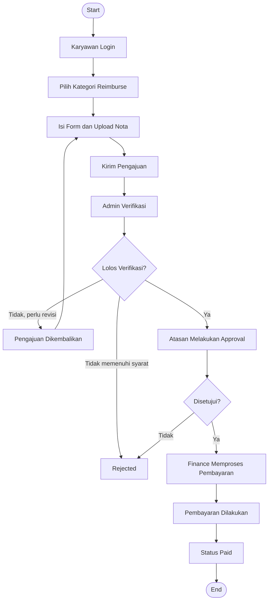

# PRODUCT REQUIREMENTS DOCUMENT (PRD)

## Sistem Informasi Reimburse Biaya Transportasi dan Konsumsi Karyawan Berbasis Web pada PT. Duta Sarana Abadi Jaya

**Versi:** 1.3  
**Status:** Draft – Updated (Frontend SvelteKit & OCR Technology Stack)  
**Platform:** Web Application  
**Jenis Aplikasi:** Internal Company Information System

---

## 1. Product Overview

### 1.1 Nama Produk

Sistem Informasi Reimburse Biaya Transportasi dan Konsumsi Karyawan Berbasis Web pada PT. Duta Sarana Abadi Jaya.

### 1.2 Deskripsi Produk

Aplikasi ini merupakan sistem informasi berbasis web yang dirancang untuk membantu proses pengajuan, verifikasi, persetujuan, pembayaran, dan pelaporan reimburse biaya transportasi dan konsumsi karyawan di PT. Duta Sarana Abadi Jaya.

Saat ini, proses pengajuan reimburse masih dilakukan secara manual. Karyawan harus mencetak bukti transaksi atau nota pengeluaran, kemudian menyerahkannya kepada admin reimburse masing-masing untuk diproses.

Melalui aplikasi ini, proses tersebut akan dialihkan ke sistem digital. Karyawan dapat mengajukan reimburse secara online dengan mengisi formulir dan mengunggah bukti transaksi. Selanjutnya, admin reimburse melakukan verifikasi administratif, atasan memberikan persetujuan, dan bagian Finance melakukan pencatatan serta pemrosesan pembayaran.

Aplikasi ini diharapkan dapat meningkatkan efisiensi administrasi, mempermudah pemantauan pengajuan, dan menyediakan dokumentasi transaksi reimburse secara terpusat.

### 1.3 Product Vision

Membangun sistem informasi reimburse yang terintegrasi untuk mempermudah pengelolaan pengajuan biaya transportasi dan konsumsi karyawan secara digital, efektif, transparan, dan terdokumentasi.

### 1.4 Product Objectives

1. Mengurangi penggunaan dokumen fisik dalam proses pengajuan reimburse.
2. Mempermudah karyawan mengajukan reimburse secara online.
3. Membantu admin melakukan verifikasi pengajuan berdasarkan kategori.
4. Mempermudah atasan memberikan persetujuan.
5. Mempermudah Finance dalam mengelola dan mencatat pembayaran.
6. Menyediakan informasi status pengajuan secara transparan.
7. Mempermudah pembuatan laporan reimburse berdasarkan periode dan kategori biaya.
8. Mengurangi input data manual melalui fitur OCR sebagai alat bantu pembacaan bukti transaksi.

---

## 2. Problem Statement

Proses reimburse biaya transportasi dan konsumsi karyawan masih dilakukan secara manual melalui pencetakan bukti transaksi dan penyerahan dokumen kepada admin reimburse.

Permasalahan yang berpotensi muncul meliputi:

1. **Ketergantungan pada dokumen fisik:** Pengajuan membutuhkan pencetakan dan penyerahan bukti transaksi secara langsung.
2. **Kesulitan pemantauan:** Karyawan tidak dapat mengetahui perkembangan pengajuan secara langsung tanpa menghubungi admin.
3. **Risiko kehilangan dokumen:** Bukti transaksi fisik berpotensi rusak atau hilang.
4. **Pengelolaan data kurang terpusat:** Data pengajuan dapat tersebar pada dokumen atau pencatatan masing-masing admin.
5. **Proses administrasi memerlukan waktu:** Admin perlu melakukan pemeriksaan dan pencatatan secara manual.
6. **Pembuatan laporan kurang efisien:** Rekapitulasi pengeluaran membutuhkan pengumpulan dan pengolahan data secara manual.

Diperlukan sistem informasi berbasis web yang dapat mengintegrasikan proses pengajuan, verifikasi, persetujuan, pembayaran, dan pelaporan reimburse.

---

## 3. Goals & Success Metrics

### 3.1 Goals

- Digitalisasi proses pengajuan reimburse.
- Sentralisasi data pengajuan transportasi dan konsumsi.
- Mempercepat proses verifikasi dan persetujuan.
- Mempermudah pencatatan pembayaran.
- Meningkatkan keteraturan dokumentasi transaksi.
- Mempermudah monitoring pengajuan oleh seluruh pihak terkait.

### 3.2 Success Metrics

| Indikator | Target |
|---|---|
| Pengajuan reimburse | Dapat dilakukan secara online |
| Bukti transaksi | Tersimpan secara digital |
| Verifikasi admin | Dilakukan melalui sistem |
| Persetujuan atasan | Dilakukan melalui sistem |
| Pencatatan pembayaran | Dikelola melalui akun Finance |
| Monitoring pengajuan | Status dapat dipantau sesuai hak akses |
| Laporan reimburse | Dapat difilter berdasarkan kategori dan periode |

---

## 4. Target Users & User Roles

Sistem memiliki enam role utama.

### 4.1 Karyawan (Employee)

Pengguna yang mengajukan reimburse atas pengeluaran transportasi dan konsumsi.

**Hak akses:**

- Login dan logout.
- Mengajukan reimburse transportasi.
- Mengajukan reimburse konsumsi.
- Mengunggah bukti transaksi.
- Melihat riwayat pengajuan.
- Memantau status pengajuan.
- Melihat catatan verifikasi dan alasan penolakan.
- Memperbaiki pengajuan yang dikembalikan.

### 4.2 Admin Reimburse Transportasi

Pengguna yang bertanggung jawab melakukan verifikasi administratif terhadap pengajuan reimburse kategori transportasi.

**Hak akses:**

- Melihat daftar pengajuan transportasi.
- Memeriksa detail pengajuan.
- Memeriksa bukti transaksi.
- Memvalidasi kelengkapan informasi dan nominal.
- Menandai pengajuan yang memenuhi persyaratan.
- Mengembalikan pengajuan untuk revisi.
- Menolak pengajuan yang tidak memenuhi ketentuan.
- Meneruskan pengajuan yang lolos verifikasi kepada atasan.
- Melihat riwayat pengajuan transportasi.
- Membuat laporan reimburse transportasi.

### 4.3 Admin Reimburse Konsumsi

Pengguna yang bertanggung jawab melakukan verifikasi administratif terhadap pengajuan reimburse kategori konsumsi.

**Hak akses:**

- Melihat daftar pengajuan konsumsi.
- Memeriksa detail pengajuan.
- Memeriksa bukti transaksi.
- Memvalidasi kelengkapan informasi dan nominal.
- Menandai pengajuan yang memenuhi persyaratan.
- Mengembalikan pengajuan untuk revisi.
- Menolak pengajuan yang tidak memenuhi ketentuan.
- Meneruskan pengajuan yang lolos verifikasi kepada atasan.
- Melihat riwayat pengajuan konsumsi.
- Membuat laporan reimburse konsumsi.

### 4.4 Atasan (Approver)

Pengguna yang bertanggung jawab memberikan persetujuan terhadap pengajuan reimburse setelah melewati tahap verifikasi admin.

**Hak akses:**

- Melihat daftar pengajuan yang membutuhkan persetujuan.
- Melihat detail pengajuan dan bukti transaksi.
- Memeriksa informasi karyawan dan keperluan reimburse.
- Menyetujui pengajuan.
- Menolak pengajuan dengan memberikan alasan.
- Mengembalikan pengajuan untuk revisi apabila diperlukan.
- Melihat riwayat persetujuan.

### 4.5 Finance / Bagian Keuangan

Pengguna yang bertanggung jawab melakukan pencatatan dan pemrosesan pembayaran reimburse setelah pengajuan mendapatkan persetujuan atasan.

**Hak akses:**

- Melihat daftar pengajuan yang telah disetujui.
- Melihat detail dan nominal reimburse.
- Memproses pembayaran reimburse.
- Memperbarui status pembayaran.
- Mencatat tanggal pembayaran.
- Mencatat informasi atau referensi transaksi pembayaran.
- Melihat riwayat pembayaran.
- Membuat dan mengunduh laporan pembayaran.

### 4.6 Super Admin

Pengguna yang bertanggung jawab terhadap pengelolaan sistem dan konfigurasi hak akses.

**Hak akses:**

- Mengelola akun pengguna.
- Menambahkan, mengubah, dan menonaktifkan akun.
- Mengatur role dan hak akses.
- Mengelola data departemen atau divisi.
- Mengatur relasi karyawan dengan atasan.
- Mengelola kategori reimburse.
- Melihat seluruh data pengajuan.
- Mengakses laporan keseluruhan.
- Melihat riwayat aktivitas sistem.

---

## 5. Product Scope

### 5.1 In Scope

Fitur yang termasuk dalam pengembangan:

1. Autentikasi dan manajemen akun pengguna.
2. Role-Based Access Control.
3. Dashboard berdasarkan role pengguna.
4. Pengajuan reimburse transportasi.
5. Pengajuan reimburse konsumsi.
6. Upload bukti transaksi.
7. Verifikasi pengajuan oleh admin.
8. Persetujuan pengajuan oleh atasan.
9. Pengembalian dan penolakan pengajuan.
10. Monitoring status pengajuan.
11. Riwayat pengajuan dan persetujuan.
12. Pencatatan pembayaran oleh Finance.
13. Laporan dan rekapitulasi reimburse.
14. Manajemen pengguna oleh Super Admin.
15. OCR untuk membaca informasi dasar pada struk dan mengisi formulir secara otomatis sebagai draft.
16. Pemeriksaan hasil OCR dan koreksi manual oleh karyawan sebelum pengajuan dikirim.

### 5.2 Out of Scope

Fitur yang tidak menjadi prioritas versi awal:

1. Integrasi dengan sistem payroll.
2. Integrasi langsung dengan rekening bank.
3. Pembayaran otomatis melalui payment gateway.
4. Integrasi dengan aplikasi akuntansi eksternal.
5. Aplikasi mobile native.
7. Integrasi dengan sistem absensi perusahaan.

---

## 6. Functional Requirements

### 6.1 Authentication & User Management

| ID | Requirement | Description | Priority |
|---|---|---|---|
| FR-001 | Login | Pengguna dapat masuk menggunakan akun terdaftar. | High |
| FR-002 | Logout | Pengguna dapat keluar dari aplikasi. | High |
| FR-003 | Role-Based Access | Sistem membatasi akses berdasarkan role. | High |
| FR-004 | User Management | Super Admin dapat mengelola akun pengguna. | High |
| FR-005 | User Profile | Pengguna dapat melihat informasi profil. | Medium |

### 6.2 Reimburse Submission

| ID | Requirement | Description | Priority |
|---|---|---|---|
| FR-006 | Pengajuan Transportasi | Karyawan dapat mengajukan reimburse transportasi. | High |
| FR-007 | Pengajuan Konsumsi | Karyawan dapat mengajukan reimburse konsumsi. | High |
| FR-008 | Upload Receipt | Karyawan dapat mengunggah bukti transaksi. | High |
| FR-009 | Input Expense | Karyawan dapat mengisi nominal dan detail pengeluaran. | High |
| FR-010 | Submission History | Karyawan dapat melihat riwayat pengajuan. | High |
| FR-011 | Edit Submission | Karyawan dapat memperbaiki pengajuan yang dikembalikan. | Medium |

### 6.3 Receipt OCR & Data Extraction

OCR digunakan sebagai alat bantu pengisian formulir, bukan sebagai pengambil keputusan kelayakan reimburse. Hasil pembacaan harus ditinjau dan dikonfirmasi oleh karyawan sebelum pengajuan dikirim.

| ID | Requirement | Description | Priority |
|---|---|---|---|
| FR-032 | Receipt Upload for OCR | Karyawan dapat mengunggah foto atau hasil pindai struk untuk diproses OCR. | High |
| FR-033 | Receipt OCR | Sistem dapat membaca teks pada gambar struk menggunakan mesin OCR. | High |
| FR-034 | Data Extraction | Sistem mencoba mengekstrak nama merchant, tanggal transaksi, dan total transaksi apabila tersedia pada struk. | High |
| FR-035 | OCR Auto-fill | Sistem mengisi field formulir reimburse menggunakan data hasil ekstraksi OCR. | High |
| FR-036 | OCR Preview | Karyawan dapat melihat hasil pembacaan OCR sebelum mengirim pengajuan. | High |
| FR-037 | Manual Correction | Karyawan dapat mengubah atau melengkapi data hasil OCR sebelum submit. | High |
| FR-038 | OCR Error Handling | Sistem menyediakan pengisian manual apabila OCR gagal atau informasi tidak dapat dibaca. | High |
| FR-039 | Image Preprocessing | Sistem melakukan preprocessing gambar seperlunya untuk membantu meningkatkan keterbacaan teks sebelum OCR dijalankan. | Medium |
| FR-040 | Field Mapping & Parsing | Sistem memetakan teks hasil OCR ke field merchant, tanggal transaksi, dan total transaksi menggunakan aturan ekstraksi yang dapat dikonfigurasi. | High |
| FR-041 | OCR Processing Status | Sistem mencatat status pemrosesan OCR, seperti queued, processing, completed, atau failed, untuk kebutuhan penanganan proses. | Medium |

### 6.4 Admin Verification

| ID | Requirement | Description | Priority |
|---|---|---|---|
| FR-012 | Admin Verification | Admin dapat memeriksa kelengkapan pengajuan. | High |
| FR-013 | Receipt Validation | Admin dapat memeriksa bukti transaksi. | High |
| FR-014 | Verification Approval | Admin dapat meneruskan pengajuan yang lolos verifikasi kepada atasan. | High |
| FR-015 | Revision Request | Admin dapat mengembalikan pengajuan untuk diperbaiki. | High |
| FR-016 | Verification Rejection | Admin dapat menolak pengajuan yang tidak memenuhi ketentuan. | High |

### 6.5 Approval Management

| ID | Requirement | Description | Priority |
|---|---|---|---|
| FR-017 | Approval Dashboard | Atasan dapat melihat pengajuan yang menunggu persetujuan. | High |
| FR-018 | Approval Action | Atasan dapat menyetujui pengajuan. | High |
| FR-019 | Rejection Action | Atasan dapat menolak pengajuan dengan alasan. | High |
| FR-020 | Approval History | Sistem menyimpan riwayat persetujuan. | High |

### 6.6 Payment Management

| ID | Requirement | Description | Priority |
|---|---|---|---|
| FR-021 | Approved Submission List | Finance dapat melihat pengajuan yang telah disetujui. | High |
| FR-022 | Payment Processing | Finance dapat memproses pembayaran reimburse. | High |
| FR-023 | Payment Status | Finance dapat memperbarui status pembayaran. | High |
| FR-024 | Payment History | Finance dapat melihat riwayat pembayaran. | High |
| FR-025 | Payment Record | Sistem menyimpan tanggal dan referensi pembayaran. | High |

### 6.7 Reporting & Monitoring

| ID | Requirement | Description | Priority |
|---|---|---|---|
| FR-026 | Status Tracking | Karyawan dapat memantau status pengajuan. | High |
| FR-027 | Admin Dashboard | Admin dapat melihat ringkasan pengajuan berdasarkan kategori. | High |
| FR-028 | Expense Report | Sistem menampilkan laporan reimburse. | High |
| FR-029 | Category Filter | Laporan dapat difilter berdasarkan kategori. | High |
| FR-030 | Period Filter | Laporan dapat difilter berdasarkan periode. | High |
| FR-031 | Export Report | Pengguna berwenang dapat mengunduh laporan. | Medium |

---

## 7. Business Rules

1. Setiap pengajuan harus berasal dari akun karyawan yang terdaftar.
2. Setiap pengajuan memiliki satu kategori, yaitu transportasi atau konsumsi.
3. Karyawan wajib mengisi detail pengeluaran dan melampirkan bukti transaksi.
4. Setiap pengajuan memiliki nomor identifikasi unik.
5. Pengajuan transportasi hanya dapat diverifikasi oleh Admin Reimburse Transportasi.
6. Pengajuan konsumsi hanya dapat diverifikasi oleh Admin Reimburse Konsumsi.
7. Pengajuan yang lolos verifikasi admin diteruskan kepada atasan.
8. Pengajuan yang belum lolos verifikasi tidak dapat diteruskan ke tahap persetujuan.
9. Atasan bertanggung jawab memberikan persetujuan atau penolakan.
10. Pengajuan yang ditolak harus memiliki alasan.
11. Pengajuan yang dikembalikan harus memiliki catatan perbaikan.
12. Finance hanya dapat memproses pengajuan yang telah mendapatkan persetujuan atasan.
13. Status Paid hanya dapat diberikan setelah pembayaran benar-benar dilakukan.
14. Setiap perubahan status harus tercatat dalam riwayat aktivitas.
15. Karyawan hanya dapat melihat pengajuan miliknya sendiri.
16. Admin hanya dapat mengakses kategori reimburse sesuai kewenangannya.
17. Finance dapat melihat pengajuan yang telah disetujui untuk diproses pembayarannya.
18. OCR hanya digunakan untuk membantu membaca informasi pada struk dan mengisi formulir reimburse.
19. Hasil OCR tidak boleh langsung dikirim sebagai pengajuan tanpa ditinjau dan dikonfirmasi oleh karyawan.
20. Karyawan bertanggung jawab memeriksa serta memastikan kebenaran merchant, tanggal transaksi, nominal, dan informasi lain sebelum submit.
21. Informasi yang tidak ditemukan atau tidak terbaca oleh OCR harus dibiarkan kosong atau dapat diisi secara manual; sistem tidak boleh mengarang nilai.
22. Karyawan dapat memperbaiki seluruh field hasil OCR sebelum pengajuan dikirim.
23. Foto atau file struk asli harus tetap disimpan sebagai bukti transaksi dan menjadi acuan pemeriksaan admin.
24. Jika OCR gagal, karyawan tetap dapat melanjutkan pengajuan melalui pengisian formulir secara manual.
25. Hasil OCR merupakan data bantu dan tidak menggantikan proses verifikasi admin maupun persetujuan atasan.

---

## 8. Reimbursement Workflow

### 8.1 Main Workflow

Urutan proses utama sistem:

1. Karyawan login ke aplikasi.
2. Karyawan memilih kategori reimburse transportasi atau konsumsi.
3. Karyawan mengisi formulir pengajuan.
4. Karyawan mengunggah bukti transaksi.
5. Karyawan mengirimkan pengajuan.
6. Sistem menyimpan pengajuan dengan status `Submitted`.
7. Admin kategori terkait menerima pengajuan.
8. Admin melakukan pemeriksaan kelengkapan data, nominal, dan bukti transaksi.
9. Jika tidak sesuai, admin dapat mengembalikan pengajuan untuk revisi atau menolaknya.
10. Jika sesuai, admin meneruskan pengajuan kepada atasan.
11. Atasan melakukan pemeriksaan dan memberikan persetujuan.
12. Jika disetujui, pengajuan diteruskan kepada Finance.
13. Finance melakukan proses pembayaran dan mencatat informasi pembayaran.
14. Finance memperbarui status menjadi `Paid`.
15. Karyawan dapat melihat status akhir pengajuan.

### 8.2 OCR Auto-fill Workflow

1. Karyawan memilih kategori reimburse transportasi atau konsumsi.
2. Karyawan mengunggah foto atau hasil pindai struk.
3. Sistem memvalidasi format dan ukuran file.
4. Sistem mengirim gambar ke mesin OCR untuk dibaca.
5. Sistem mengekstrak informasi yang dikenali, terutama merchant, tanggal transaksi, dan total transaksi.
6. Sistem menampilkan hasil ekstraksi pada formulir reimburse.
7. Karyawan memeriksa hasil OCR dan membandingkannya dengan struk asli.
8. Karyawan dapat memperbaiki atau melengkapi informasi yang salah atau belum terbaca.
9. Jika OCR gagal, karyawan dapat mengisi formulir secara manual.
10. Setelah seluruh informasi dipastikan benar, karyawan mengirim pengajuan.
11. Pengajuan masuk ke alur verifikasi admin, persetujuan atasan, dan pemrosesan Finance seperti biasa.

### 8.3 Workflow Diagram



### 8.4 Proposed Status

| Status | Description |
|---|---|
| Draft | Pengajuan masih dalam proses pengisian. |
| Submitted | Pengajuan telah dikirim oleh karyawan. |
| Under Review | Pengajuan sedang diperiksa admin. |
| Revision Required | Pengajuan dikembalikan untuk diperbaiki. |
| Rejected | Pengajuan ditolak oleh admin atau atasan. |
| Pending Approval | Pengajuan menunggu persetujuan atasan. |
| Approved | Pengajuan telah disetujui atasan. |
| Processing Payment | Finance sedang memproses pembayaran. |
| Paid | Pembayaran reimburse telah dilakukan. |

---

## 9. Non-Functional Requirements

### 9.1 Security

- Sistem menerapkan autentikasi pengguna.
- Password disimpan menggunakan metode hashing.
- Sistem menerapkan pembatasan hak akses berdasarkan role.
- Pengguna tidak dapat mengakses data di luar kewenangannya.
- Bukti transaksi hanya dapat diakses oleh pihak berwenang.
- Aktivitas penting pengguna dicatat dalam sistem.

### 9.2 Performance

- Sistem dapat memproses pengajuan tanpa waktu tunggu berlebihan.
- Dashboard menampilkan data secara efisien.
- Upload file memiliki batas ukuran dan tipe file yang diizinkan.

### 9.3 Reliability

- Sistem memiliki validasi input.
- Sistem menangani kegagalan penyimpanan dengan baik.
- Data pengajuan dan pembayaran tersimpan secara konsisten.

### 9.4 Usability

- Antarmuka mudah dipahami.
- Navigasi disesuaikan dengan role.
- Formulir pengajuan dibuat sederhana.
- Sistem memberikan notifikasi keberhasilan atau kegagalan tindakan.

### 9.5 Compatibility

- Sistem dapat diakses melalui browser modern.
- Tampilan mendukung desktop dan perangkat mobile.

### 9.6 OCR Processing & Data Quality

- Sistem harus mendukung pemrosesan gambar struk dengan format file yang ditentukan, misalnya JPG, JPEG, dan PNG.
- Sistem harus membatasi ukuran file unggahan sesuai konfigurasi aplikasi.
- Sistem harus memberikan informasi apabila gambar tidak dapat diproses, format tidak didukung, atau hasil pembacaan tidak tersedia.
- Sistem tidak boleh mengisi informasi yang tidak berhasil dikenali dengan nilai perkiraan atau nilai buatan.
- Hasil OCR harus ditampilkan agar dapat diperiksa dan dikoreksi oleh karyawan.
- Sistem harus mempertahankan file struk asli sebagai bukti transaksi.
- Keberhasilan OCR dapat dipengaruhi kualitas gambar, kondisi cetakan, tata letak, dan jenis struk; karena itu sistem tetap menyediakan input manual.

### 9.7 Privacy & Access Control for Receipts

- File struk dan hasil OCR hanya dapat diakses oleh pengguna yang memiliki kewenangan terhadap pengajuan terkait.
- File yang diunggah harus diperiksa tipe dan ukurannya sebelum diproses.
- Sistem tidak boleh menampilkan file bukti transaksi kepada pengguna yang tidak berwenang.

---

## 10. Data Requirements

Entitas data utama:

| Entity | Description |
|---|---|
| Users | Menyimpan informasi akun pengguna. |
| Roles | Menyimpan jenis role pengguna. |
| Departments | Menyimpan informasi departemen atau divisi. |
| Reimbursements | Menyimpan data utama pengajuan. |
| Reimbursement Details | Menyimpan rincian pengeluaran. |
| Receipts | Menyimpan informasi file bukti transaksi asli. |
| OCR Results | Menyimpan hasil ekstraksi OCR yang terkait dengan bukti transaksi. |
| Approvals | Menyimpan riwayat verifikasi dan persetujuan. |
| Payments | Menyimpan informasi pembayaran. |
| Activity Logs | Menyimpan riwayat aktivitas sistem. |

### 10.1 Informasi Utama Pengajuan

- Reimbursement ID
- Employee ID
- Category
- Transaction Date
- Expense Description
- Expense Amount
- Receipt Attachment
- Submission Date
- Current Status

### 10.2 Informasi Pembayaran

- Payment ID
- Reimbursement ID
- Payment Amount
- Payment Date
- Payment Reference
- Payment Status
- Processed By

### 10.3 Informasi Bukti Transaksi dan OCR

**Data bukti transaksi (Receipts):**
- Receipt ID
- Reimbursement ID
- Original File Name
- Stored File Path atau Storage Key
- File Type
- File Size
- Upload Date
- Uploaded By

**Data hasil OCR (OCR Results):**
- OCR Result ID
- Receipt ID
- Extracted Merchant
- Extracted Transaction Date
- Extracted Total Amount
- Raw OCR Text (opsional, sesuai kebutuhan implementasi)
- Processing Status
- Processed At

Data hasil OCR harus dibedakan dari data pengajuan yang telah dikonfirmasi. Nilai pada formulir reimburse menjadi data pengajuan setelah diperiksa dan disimpan oleh karyawan. Sistem sebaiknya mencatat bahwa data tersebut telah dikonfirmasi atau dikoreksi sebelum submit.

---

## 11. UI/UX Requirements

### 11.1 General Interface

- Desain antarmuka profesional, konsisten, dan sederhana.
- Frontend dikembangkan menggunakan Svelte 5 dengan SvelteKit dan TypeScript.
- Komponen antarmuka dibuat reusable agar elemen seperti form, tabel, modal, status badge, dan navigasi konsisten.
- Dashboard menampilkan informasi sesuai role.
- Navigasi menggunakan sidebar atau menu utama.
- Tabel pengajuan dilengkapi pencarian dan filter.
- Status pengajuan ditampilkan menggunakan label yang mudah dibedakan.

### 11.2 Main Pages

| Page | Description |
|---|---|
| Login | Halaman autentikasi pengguna. |
| Employee Dashboard | Ringkasan pengajuan milik karyawan. |
| Submission Form | Formulir pengajuan reimburse. |
| Submission History | Riwayat pengajuan karyawan. |
| Admin Dashboard | Daftar pengajuan sesuai kategori admin. |
| Verification Detail | Halaman pemeriksaan detail pengajuan. |
| Approval Dashboard | Daftar pengajuan yang menunggu persetujuan. |
| Finance Dashboard | Daftar pengajuan yang menunggu pembayaran. |
| Payment Detail | Halaman pencatatan pembayaran. |
| Report Page | Halaman laporan dan rekapitulasi. |
| User Management | Halaman pengelolaan akun pengguna. |

---

## 12. Acceptance Criteria

Sistem dinyatakan memenuhi kebutuhan awal apabila:

1. Pengguna dapat login sesuai akun dan role masing-masing.
2. Karyawan dapat mengajukan reimburse transportasi dan konsumsi.
3. Karyawan dapat mengunggah bukti transaksi.
4. Sistem menyimpan data pengajuan secara terpusat.
5. Admin dapat melihat pengajuan berdasarkan kategori tanggung jawabnya.
6. Admin dapat melakukan verifikasi pengajuan.
7. Admin dapat mengembalikan pengajuan untuk revisi.
8. Admin dapat meneruskan pengajuan yang lolos verifikasi kepada atasan.
9. Atasan dapat menyetujui atau menolak pengajuan.
10. Finance dapat melihat pengajuan yang telah disetujui.
11. Finance dapat mencatat dan memperbarui status pembayaran.
12. Karyawan dapat memantau perkembangan status pengajuan.
13. Sistem dapat menampilkan riwayat pengajuan dan persetujuan.
14. Sistem dapat menghasilkan laporan berdasarkan kategori dan periode.
15. Pembatasan akses berdasarkan role berjalan sesuai ketentuan.
16. Karyawan dapat mengunggah foto atau hasil pindai struk dengan format dan ukuran yang didukung.
17. Sistem dapat memproses gambar struk menggunakan OCR.
18. Sistem menampilkan hasil pembacaan merchant, tanggal transaksi, dan total transaksi apabila informasi tersebut berhasil dikenali.
19. Sistem mengisi field formulir berdasarkan hasil OCR yang tersedia.
20. Karyawan dapat meninjau dan mengoreksi hasil OCR sebelum mengirim pengajuan.
21. Sistem tidak mengirim pengajuan secara otomatis hanya berdasarkan hasil OCR.
22. Jika OCR gagal atau sebagian informasi tidak terbaca, karyawan tetap dapat mengisi formulir secara manual.
23. File struk asli tetap tersimpan dan dapat diperiksa oleh admin yang berwenang.
24. Data hasil OCR tidak menggantikan proses verifikasi admin dan persetujuan atasan.

---

## 13. Technical Constraints & Dependencies

### 13.1 Constraints

- Aplikasi dikembangkan sebagai sistem berbasis web.
- Aplikasi ditujukan untuk penggunaan internal perusahaan.
- Proses reimburse mengikuti kebijakan perusahaan.
- Sistem membutuhkan koneksi jaringan untuk diakses.
- Pembayaran dilakukan melalui proses keuangan perusahaan, bukan melalui payment gateway aplikasi.

### 13.2 Recommended Technology Stack

Stack berikut ditetapkan sebagai baseline teknis untuk pengembangan versi awal. Pemilihan akhir versi library dan konfigurasi deployment perlu divalidasi melalui uji kompatibilitas pada environment pengembangan dan server target.

| Layer | Teknologi | Peran |
|---|---|---|
| Frontend Framework | Svelte 5 | Membangun antarmuka interaktif berbasis komponen. |
| Frontend Framework / Routing | SvelteKit | Mengatur routing halaman, layout, struktur aplikasi frontend, dan proses build. |
| Frontend Language | TypeScript | Menambahkan pemeriksaan tipe data pada kode frontend agar lebih mudah dipelihara. |
| Styling | Tailwind CSS | Mengatur tampilan responsif dan konsistensi desain antarmuka. |
| Backend Web & API | Python + Flask | Menangani autentikasi, proses pengajuan, workflow reimburse, validasi bisnis, API, dan integrasi OCR. |
| API Communication | REST API (JSON) | Menjadi jalur komunikasi antara frontend SvelteKit dan backend Flask. |
| OCR Engine | PaddleOCR | Mendeteksi area teks dan mengenali teks pada gambar struk. |
| Image Processing | OpenCV | Membantu preprocessing gambar, misalnya resize, grayscale, denoising, thresholding, dan koreksi orientasi bila diperlukan. |
| OCR Result Parser | Python (rule-based) | Mengolah teks OCR dan mengidentifikasi kandidat merchant, tanggal transaksi, serta total transaksi berdasarkan pola teks dan kata kunci. |
| Database | PostgreSQL (rekomendasi) | Menyimpan pengguna, pengajuan, status, hasil OCR, persetujuan, pembayaran, dan audit log. Penggunaan PostgreSQL perlu dikonfirmasi dengan standar/infrastruktur perusahaan. |
| ORM | SQLAlchemy | Mengelola interaksi backend Flask dengan database relasional. |
| File Storage | Server-side file storage | Menyimpan file struk asli secara terpisah dari data hasil ekstraksi. |
| Web Server / Reverse Proxy | Nginx | Menyajikan hasil build frontend dan meneruskan request API ke backend Flask. |

**Keputusan frontend:** Svelte 5 digunakan sebagai framework antarmuka, sedangkan SvelteKit digunakan untuk routing, layout, dan pengelolaan struktur aplikasi. TypeScript digunakan untuk membantu menjaga konsistensi tipe data, sementara Tailwind CSS digunakan untuk styling responsif. Aplikasi ini merupakan sistem internal berbasis dashboard; rendering sisi server (SSR) tidak wajib untuk versi awal. Frontend dapat dibangun sebagai static application apabila kebutuhan implementasi tidak memerlukan SSR.

**Keputusan backend:** Flask tetap menjadi backend utama yang menyediakan REST API. Seluruh validasi bisnis, autentikasi, otorisasi berdasarkan role, pengelolaan workflow, penyimpanan data, dan proses OCR dilakukan di sisi backend. Frontend tidak boleh menjadi satu-satunya lapisan pengamanan akses atau penentu status pengajuan.

**Keputusan database:** PostgreSQL dan SQLAlchemy merupakan rekomendasi awal, bukan keputusan final yang mengesampingkan standar perusahaan. Jika perusahaan telah memiliki DBMS yang ditetapkan, implementasi perlu menyesuaikan DBMS tersebut.

**Keputusan OCR:** PaddleOCR digunakan sebagai mesin OCR utama, bukan EasyOCR. OpenCV digunakan sebagai komponen preprocessing sesuai hasil pengujian. Setelah PaddleOCR menghasilkan teks beserta informasi posisi/hasil pengenalan, parser berbasis aturan Python mencoba mengidentifikasi field yang dibutuhkan.

**Batasan ekstraksi:** OCR dan parser tidak menjamin seluruh format struk dapat dikenali dengan benar. Parser harus mengembalikan nilai kosong apabila field tidak ditemukan atau ambigu; sistem tidak boleh menebak nilai. Nilai hasil ekstraksi tetap berstatus draft sampai ditinjau dan dikonfirmasi oleh karyawan.

### 13.3 Application Architecture

Aplikasi menggunakan arsitektur frontend dan backend yang dipisahkan (*separated frontend-backend architecture*). Frontend SvelteKit berkomunikasi dengan backend Flask melalui REST API menggunakan format JSON untuk pertukaran data.

Komponen utama:

1. **Frontend (SvelteKit):** Menampilkan halaman login, dashboard berdasarkan role, formulir pengajuan, upload dan preview struk, pemeriksaan hasil OCR, halaman verifikasi, persetujuan, pembayaran, serta laporan.
2. **Backend (Flask):** Menyediakan endpoint API, autentikasi, otorisasi, validasi input, aturan bisnis, workflow reimburse, dan pengelolaan data.
3. **OCR Processing (PaddleOCR + OpenCV + Python Parser):** Memproses gambar struk dan mengembalikan kandidat data merchant, tanggal transaksi, serta total transaksi.
4. **Database (PostgreSQL atau DBMS yang disetujui perusahaan):** Menyimpan data akun, pengajuan, status, hasil OCR, persetujuan, pembayaran, dan log aktivitas.
5. **File Storage:** Menyimpan file struk asli dengan akses terbatas.
6. **Nginx:** Menyajikan frontend hasil build dan meneruskan request dengan prefix `/api/` ke backend Flask.

Untuk deployment awal, frontend dapat di-build menjadi file statis dan disajikan oleh Nginx. Nginx dapat mengarahkan request halaman ke frontend dan request `/api/` ke Flask. Dengan penggunaan domain yang sama, kebutuhan konfigurasi CORS dapat diminimalkan. Pada lingkungan development yang menjalankan frontend dan backend pada origin berbeda, CORS perlu dikonfigurasi secara terbatas hanya untuk origin frontend yang diizinkan.

Autentikasi perlu menggunakan mekanisme sesi yang aman. Untuk deployment satu domain, penggunaan session berbasis cookie dengan atribut `HttpOnly`, `Secure` pada HTTPS, dan `SameSite` yang sesuai dapat dipertimbangkan. Jika menggunakan token, penyimpanan dan pengelolaan token harus dirancang secara aman. Detail final mengikuti kebutuhan deployment dan kebijakan keamanan perusahaan.

### 13.4 OCR Processing Architecture

Alur pemrosesan yang direkomendasikan:

1. Karyawan memilih atau mengambil foto struk melalui antarmuka frontend SvelteKit.
2. Frontend mengirim gambar ke endpoint OCR backend Flask melalui REST API.
3. Backend memvalidasi ekstensi, MIME type, ukuran file, dan menyimpan file asli dengan nama penyimpanan yang aman.
4. Backend menyiapkan salinan kerja gambar dan menjalankan preprocessing OpenCV jika diperlukan.
5. PaddleOCR melakukan deteksi dan pengenalan teks pada gambar.
6. Parser Python menganalisis teks OCR untuk memperoleh kandidat merchant, tanggal transaksi, dan total transaksi.
7. Backend menyimpan hasil ekstraksi dan status proses OCR.
8. Backend mengirim hasil OCR ke frontend sebagai data draft.
9. Frontend menampilkan hasil ekstraksi pada formulir agar karyawan dapat membandingkan dengan struk asli dan mengoreksi nilainya.
10. Pengajuan baru dapat dikirim setelah karyawan menyelesaikan pemeriksaan dan validasi formulir.

Endpoint seperti `POST /api/ocr/scan` dapat digunakan sebagai rancangan awal untuk pemrosesan OCR. Endpoint tersebut merupakan usulan teknis dan dapat disesuaikan saat perancangan API lebih rinci.

Pemrosesan OCR dilakukan di sisi server agar model OCR dan file bukti transaksi tidak perlu diproses langsung di browser pengguna. Untuk versi awal, pemrosesan dapat dijalankan secara sinkron untuk gambar berukuran wajar. Jika waktu proses atau beban server meningkat, pemrosesan dapat dipindahkan ke background worker/queue pada pengembangan berikutnya.

### 13.5 Proposed Project Structure

Struktur repository yang direkomendasikan memisahkan kode frontend dan backend agar pengembangan serta pemeliharaan lebih terorganisasi.

```text
reimbursement-system/
├── frontend/
│   ├── src/
│   │   ├── lib/
│   │   │   ├── components/
│   │   │   ├── services/       # Client untuk REST API
│   │   │   └── types/          # TypeScript types/interfaces
│   │   ├── routes/
│   │   │   ├── login/
│   │   │   ├── dashboard/
│   │   │   ├── reimburse/
│   │   │   ├── verification/
│   │   │   ├── approval/
│   │   │   ├── finance/
│   │   │   └── reports/
│   │   └── app.html
│   ├── static/
│   ├── package.json
│   └── svelte.config.js
│
├── backend/
│   ├── app/
│   │   ├── routes/             # REST API endpoints
│   │   ├── services/           # Business logic
│   │   ├── models/             # Database models
│   │   ├── ocr/
│   │   │   ├── engine.py
│   │   │   ├── preprocessing.py
│   │   │   └── parser.py
│   │   └── utils/
│   ├── migrations/
│   ├── config.py
│   └── requirements.txt
│
├── deployment/
│   └── nginx/
│
└── README.md
```

Struktur tersebut bersifat usulan awal dan dapat disesuaikan dengan kompleksitas aplikasi serta standar pengembangan perusahaan.

### 13.6 Dependencies

- Node.js dan package manager yang kompatibel dengan SvelteKit untuk pengembangan serta proses build frontend.
- Runtime Python dan dependency yang kompatibel dengan Flask, PaddleOCR, OpenCV, SQLAlchemy, serta library pendukungnya.
- Database relasional yang disepakati, dengan PostgreSQL sebagai rekomendasi awal.
- Web server/reverse proxy untuk menyajikan frontend dan meneruskan request API.
- Penyimpanan file untuk bukti transaksi.
- Data akun karyawan dan struktur organisasi.
- Kebijakan perusahaan mengenai nominal dan prosedur reimburse.
- Ketersediaan bagian Finance untuk melakukan pemrosesan pembayaran.
- Model PaddleOCR yang diperlukan tersedia pada server atau dapat diunduh dan disiapkan saat deployment.
- Kapasitas CPU, RAM, dan ruang penyimpanan server mencukupi untuk pemrosesan gambar dan penyimpanan bukti transaksi.

---

## 14. Risks & Assumptions

### 14.1 Risks

- Perubahan prosedur reimburse dapat memengaruhi alur sistem.
- Bukti transaksi yang diunggah mungkin tidak lengkap atau tidak terbaca.
- Kesalahan pengaturan role dapat menyebabkan akses tidak sesuai.
- Keterlambatan verifikasi atau persetujuan dapat menghambat proses.
- Keterlambatan pemrosesan pembayaran dapat memengaruhi penyelesaian reimburse.
- Hasil OCR dapat keliru akibat gambar buram, pencahayaan buruk, tinta pudar, struk terlipat, atau variasi format struk.
- Perbedaan versi Python, PaddleOCR, PaddlePaddle, OpenCV, dan dependency lain dapat menimbulkan kendala instalasi atau deployment.
- Parser berbasis aturan dapat gagal mengidentifikasi field jika format struk berbeda dari pola yang diuji.

### 14.2 Assumptions

- Setiap karyawan memiliki akun untuk mengakses sistem.
- Pengajuan reimburse wajib disertai bukti transaksi.
- Admin transportasi dan konsumsi memiliki kewenangan berbeda.
- Atasan bertanggung jawab memberikan persetujuan.
- Finance merupakan role terpisah dengan dashboard tersendiri.
- Finance bertanggung jawab melakukan pencatatan pembayaran.
- Detail nominal dan batas waktu pengajuan mengikuti kebijakan perusahaan.
- Karyawan memiliki perangkat yang dapat mengambil foto atau mengunggah gambar struk.
- Hasil OCR merupakan saran pengisian data dan selalu memerlukan pemeriksaan karyawan.
- Pada versi awal, OCR difokuskan pada informasi dasar seperti merchant, tanggal transaksi, dan total transaksi.
- PaddleOCR menjadi mesin OCR utama; OpenCV dan parser rule-based Python digunakan sebagai komponen pendukung.
- Sistem memiliki akses ke server dengan resource yang cukup untuk menjalankan proses OCR.

---

## 15. Future Improvements

Pengembangan lanjutan yang dapat dipertimbangkan:

1. Integrasi notifikasi melalui email atau WhatsApp.
2. Integrasi dengan sistem HR perusahaan.
3. Ekstraksi detail item transaksi secara lebih lengkap.
4. Confidence score untuk setiap field hasil OCR.
5. Deteksi kemungkinan struk duplikat.
6. Dashboard analisis pengeluaran reimburse.
7. Integrasi dengan sistem akuntansi perusahaan.
8. Pengembangan aplikasi mobile.

---

## 16. Open Questions

Hal-hal yang masih perlu dikonfirmasi kepada perusahaan:

1. Apakah terdapat batas nominal reimburse transportasi dan konsumsi?
2. Apakah terdapat batas waktu maksimal pengajuan setelah transaksi dilakukan?
3. Apakah satu pengajuan dapat berisi beberapa bukti transaksi?
4. Apakah setiap karyawan memiliki atasan langsung yang berbeda?
5. Apakah Finance melakukan pembayaran melalui transfer bank atau metode lainnya?
6. Apakah Finance memerlukan bukti pembayaran untuk diunggah ke sistem?
7. Apakah admin memiliki kewenangan menolak pengajuan secara final atau hanya mengembalikannya untuk revisi?
8. Apakah laporan harus tersedia dalam format Excel, PDF, atau keduanya?
9. Apakah terdapat ketentuan khusus untuk jenis transportasi dan konsumsi yang dapat direimburse?

---

**End of Product Requirements Document (PRD)**
